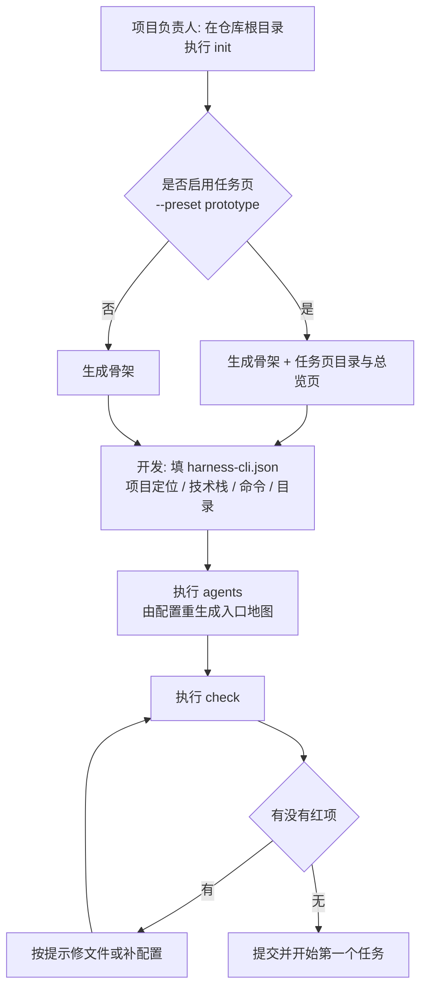
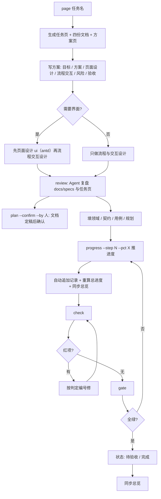
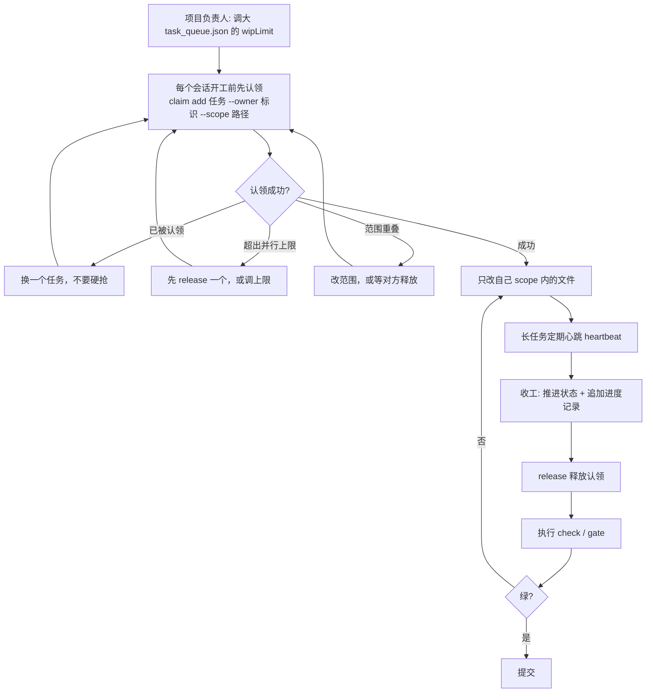
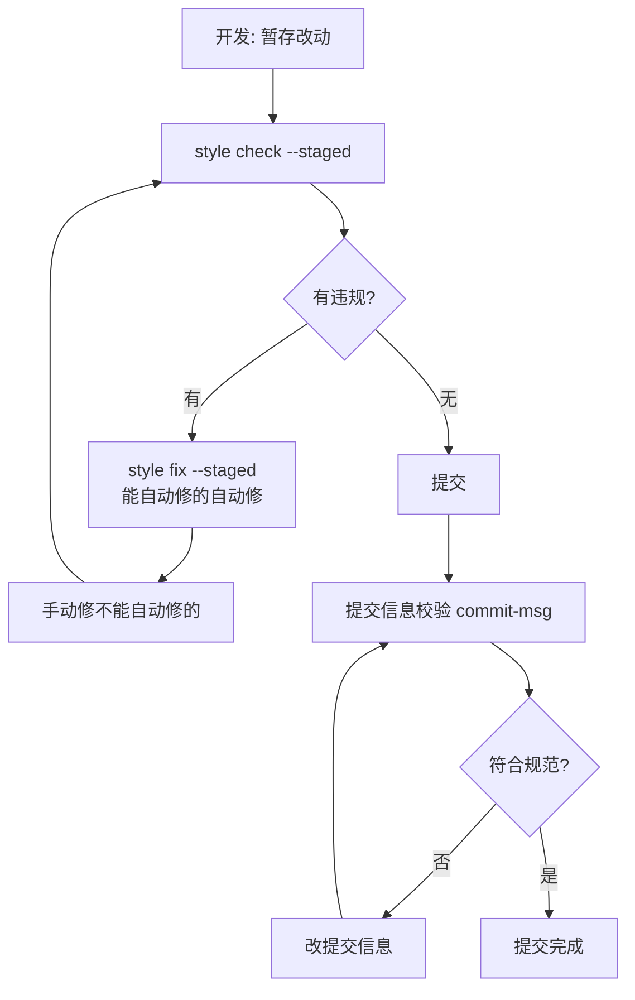
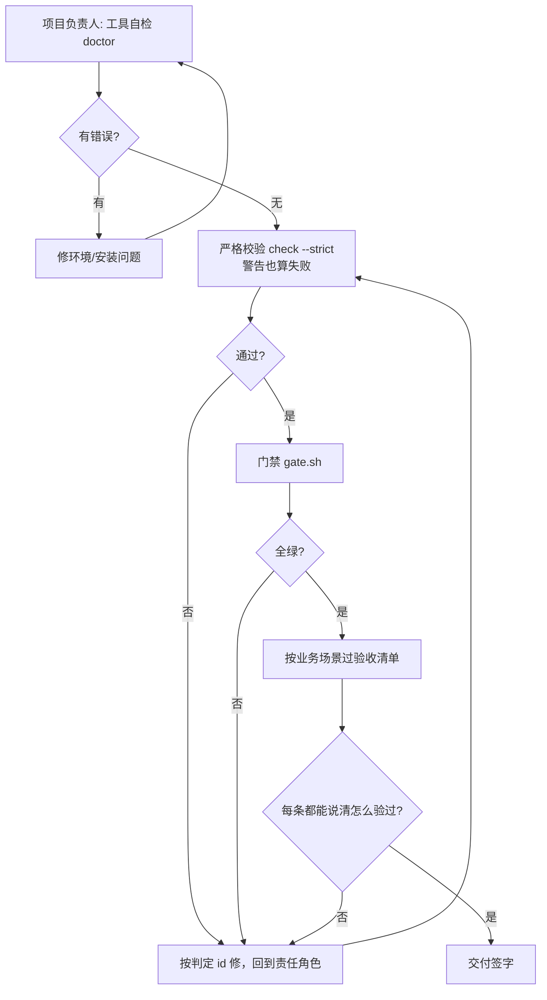

# 业务流程

> 读者：实施、产品、测试、项目负责人。**每张流程图后面都有文字复述**：图看不懂时看文字，文字有歧义时以图为准。
> 五条主流程：新项目接入、单任务交付、多会话并行、代码风格与提交、交付验收。

---

## 1. 新项目接入

**文字复述**

- **谁**：项目负责人发起，开发配合填配置。
- **什么时候**：仓库刚建立，或老项目第一次引入规范。
- **系统怎么响应**：`init` 只写**缺失或为空**的文件；已存在的非空文件一律保留（要覆盖必须显式加 `--force`）；四类状态文件（功能清单、进度日志、任务日志、任务队列）即使 `--force` 也不覆盖。
- **异常怎么走**：
  - 配置写错 → `check` 报配置类错误（退出码 1），按提示改配置再跑。
  - 工具本身坏了（模板缺失、Node 版本过低）→ 退出码 2，先修环境，不要改业务文件。
  - 入口地图行数超限 → 警告；超过上限则失败，需把细节拆到 `docs/` 再生成。

---

## 2. 单任务交付

**文字复述**

- **谁**：开发或 Agent 写方案与实现；产品/负责人确认方案；测试按契约验收。
- **什么时候**：接到一个业务任务时，第一步就建页，而不是做完再补。
- **开工前先问**：Agent 先让用户选「手动」（每步等确认）还是「自动 loop」（自动推进，所有确认 / 选择走推荐项）；
  未回答不开工。
- **顺序不能颠倒**：先完善并定稿 `docs/specs/<任务>/*.md`（人可直接改）→ 需要界面时先页面设计（ui）
  再流程交互设计 → Agent 复盘（review）→ **人确认**（plan --confirm）→ 才允许推进度。
  未确认时 `progress` 直接拒绝（退出码 1），`check` 的 P21 也会失败；**确认后文档再被改，确认立即失效**（P22）。
- **系统怎么响应**：
  - `page` 一次生成「任务页 + 提案 + 契约 + 设计 + 任务规划」，已存在的文件不覆盖；随后自动刷新总览页。
  - 新建的页面是**骨架**（留着「待填」），此时校验必然失败——这是设计，不是故障。
  - 每一步变化（开始 / 完成 / 阻塞 / 改规划）都立刻更新任务页并追加记录，不攒到收工；
    末条记录的总进度必须等于页面汇总值，否则判定失败。
- **异常怎么走**：
  - 契约与页面对不上（编号多一条少一条）→ 文档一致性判定失败，先对齐再提交。
  - 用例没挂到契约、或契约没有用例 → TDD 判定失败。
  - 总览页没刷新 → 过期判定失败，跑一次 `--sync` 即可（只重写总览，不动任务页）。
  - 标「完成」但还有步骤不到 100% 或还有红用例 → 直接失败。

---

## 3. 多会话并行

**文字复述**

- **谁**：项目负责人定并行上限；每个会话（人或多个 Agent）各自认领。
- **什么时候**：需要两个人/两个会话同时推进同一仓库时。
- **系统怎么响应**：
  - 认领是**独占创建**：两个会话同时抢同一个任务，只有一个成功，另一个收到「已被认领」。
  - 认领数达到并行上限后再认领会直接拒绝。
  - 两份认领的文件范围（`scope`）重叠时拒绝，避免两台机器改同一批文件。
  - 认领文件写在仓库里，是「谁在做什么」的唯一事实来源。
- **异常怎么走**：
  - 任务做完了但忘了释放 → 校验报「已完成却还占着认领」。
  - 会话崩溃、心跳超时 → 校验只给**警告**，不自动删；确认后可手动清理陈旧认领。
  - 有人改了别人的范围 → 校验发现范围重叠并失败。

---

## 4. 代码风格与提交

**文字复述**

- **谁**：开发；门禁可挂在提交钩子上。
- **什么时候**：提交前。
- **系统怎么响应**：参数原样转给随包的风格工具，退出码原样返回（0 通过 / 1 有违规 / 2 工具或环境问题）。能自动修的用修复命令，修不了的手工改。
- **异常怎么走**：
  - 机器没有 python3 → 该能力退出码 2，其余能力不受影响；提示先装运行环境。
  - 只是风格违规 → 退出码 1，按提示改完重跑，不要用跳过钩子的方式提交。

---

## 5. 交付验收

**文字复述**

- **谁**：项目负责人组织；产品、测试、业务参与场景验收。
- **什么时候**：上线/交付前。
- **系统怎么响应**：自检确认工具与环境没问题；严格校验把警告也当失败；门禁把 lint、测试、并行上限与认领串成一条链，任一步失败即停。
- **异常怎么走**：
  - 自检报环境错误 → 先修环境，不要继续校验（退出码 2 的语义是「工具坏了」）。
  - 校验有红项 → 按判定编号定位责任角色，修完重跑，不做例外放行。
  - 门禁绿但场景验收不过 → 以场景为准：门禁只覆盖机械可判定部分。
