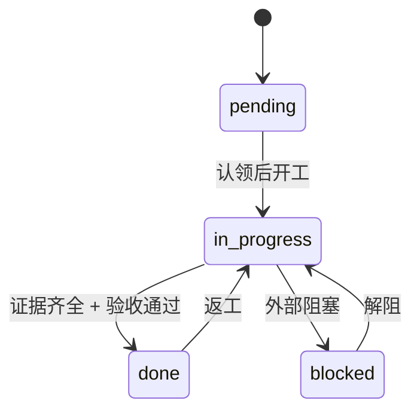

# 业务规则与状态

> 读者：产品、测试。**本页是口径依据**：系统里所有状态的含义、业务规则、以及违反后果。
> 争议时以本页为准；发现本页与实际行为不一致，先修判定，再改本页（或反过来），不允许两套口径并存。

## 1. 状态一：功能（范围）状态

功能清单里的每条功能只有一个状态，取值四选一：

| 状态 | 含义 | 允许的前一个状态 | 离开条件 |
|---|---|---|---|
| `pending` | 还没开始 | 任意 | 认领后改 `in_progress` |
| `in_progress` | 正在做（数量受并行上限约束） | `pending` | 完成并写证据 → `done`；或转 `blocked` |
| `done` | 已完成，**必须有证据** | `in_progress` | 一般不再改；要返工则回到 `in_progress` |
| `blocked` | 被外部原因卡住（等接口、等数据、等决策） | `pending` / `in_progress` | 解阻后回 `in_progress` |

**文字复述**：功能一开始是「未开始」；被认领并开工后变「进行中」；同时处于「进行中」的功能数量不得超过并行上限（默认 1）；只有证据充足才算「已完成」；被外部卡住标「被阻塞」，解阻后回到「进行中」；返工从「已完成」退回「进行中」。

## 2. 状态二：任务页状态

任务页（每个任务一页）有三个状态：

| 状态 | 含义 | 允许条件 |
|---|---|---|
| 进行中 | 正在推进 | 默认状态 |
| 待验收 | 步骤全部 100%，等待验收 | **所有步骤必须 100%** |
| 完成 | 已验收 | **所有步骤 100% + 所有用例为绿** |

约束：总进度 100% 时页面里不允许还留着「待跑 / 待验收」字样（互斥）；总进度由步骤等权汇总，不手填。

## 3. 状态三：认领

| 字段 | 取值 | 含义 |
|---|---|---|
| 状态 | `active` | 有效认领（本系统只有这一种状态，释放即删除文件） |
| 第几轮 | 正整数 | 同一认领人的第几轮迭代，便于回看 |
| 心跳 | 时间 | 超过配置时长（默认 12 小时）未更新 → 只警告 |

## 4. 状态四：命令结果（退出码）

| 退出码 | 含义 | 谁该处理 |
|---|---|---|
| 0 | 通过（可能有警告） | 无 |
| 1 | 有违规（可预期失败） | 责任角色按判定 id 修 |
| 2 | 工具或用法有错 | 先修环境/参数，不要改业务文件 |

## 5. 状态五：开关

| 开关 | 默认 | 作用 | 关闭后 |
|---|---|---|---|
| 任务页能力 | 关 | 一个任务一页 + 总览 + 页面校验 | 不生成任务页，不跑 P 类判定 |
| 并行认领 | 开 | 认领文件与 C2xx 判定 | 生成物保留，判定与门禁里的认领步骤跳过 |
| 并行上限 | 1 | 同时进行中的功能数量 | 超过即失败（单任务模式下等价于「单 WIP」） |
| 认领心跳时长 | 12 小时 | 陈旧认领的判定阈值 | 不适用 |

## 6. 业务规则清单

| 编号 | 规则 | 违反后果（判定 / 退出码） |
|---|---|---|
| R-01 | 不覆盖已存在的非空文件，除显式要求覆盖 | 生成命令保留文件（KEEP），不报错 |
| R-02 | 四类状态文件即使要求覆盖也不覆盖 | 同上；需显式「连状态一起覆盖」才写 |
| R-03 | 入口地图由配置生成，不手改 | A106 警告（与配置不同源） |
| R-04 | 入口地图八节齐全、引用路径必须存在 | A102 / A104 错误 |
| R-05 | 入口地图不超过建议行数，超过上限失败 | A103 警告 / A103 错误 |
| R-06 | 同时进行中的功能数 ≤ 并行上限 | F107 错误 |
| R-07 | 功能完成必须有证据 | F106 错误 |
| R-08 | 功能编号唯一且格式合法；依赖必须存在、无环 | F104 / F108 / F109 错误 |
| R-09 | 门禁脚本必须「遇错即停」且可执行 | H102 错误/警告 |
| R-10 | 进度日志必须包含「下一步行动」 | H103 错误 |
| R-11 | 版本说明四段齐全、有编号条目、无待补 | V102 / V103 / V104 错误 |
| R-12 | 忽略规则八条齐全 | G101 错误 |
| R-13 | 每个进行中的功能必须有认领 | C201 错误 |
| R-14 | 认领必须指向存在且未结束的功能 | C202 错误 |
| R-15 | 两份认领的路径不能相同或互为前缀 | C203 错误 |
| R-16 | 认领数不得超过并行上限 | C205 错误 |
| R-17 | 认领必须有认领人与开始时间 | C206 错误 |
| R-18 | 认领建议声明范围，否则无法判断冲突 | C207 警告 |
| R-19 | 心跳超时只警告，不自动删 | C204 警告 |
| R-20 | 任务规划步骤编号从 1 连续、标题不能是占位 | P4 错误 |
| R-21 | 总进度不手填；手填必须与汇总一致 | P5 错误 |
| R-22 | 总进度 100% 时不得再有「待跑 / 待验收」 | P6 错误 |
| R-23 | 每条用例必须挂在存在的契约上，编号唯一 | P8 / P15 错误 |
| R-24 | 每条契约至少一条用例；标「完成」不得有红用例 | P15 错误 |
| R-25 | 每个规划步骤必须绑定存在的契约 | P16 错误 |
| R-26 | 进度记录末条总进度 = 页面汇总；时间递增 | P9 错误 |
| R-27 | 任务状态只能三选一；完成/待验收要求全部步骤 100% | P10 错误 |
| R-28 | 总览页必须与任务页一致（进行中任务不能漏） | P11 错误 |
| R-29 | 领域段四要素齐全（上下文 / ≥3 术语 / 聚合 / 不变量） | P13 错误 |
| R-30 | 契约 ≥2 条，六格都填，编号唯一且两处一致 | P14 错误 |
| R-31 | 规范文档四份齐全且不留待填 | P17 错误 |
| R-32 | 文档与页面一致：步骤数与标题、契约编号集合 | P18 错误 |
| R-33 | 设计文档必须含 DDD 四段 | P19 错误 |
| R-34 | 任务目录数不超过保留上限 | P1 错误（可先预览清理） |
| R-35 | 风格与提交信息按统一规则判定 | 风格命令退出码 1 |
| R-36 | 校验只读，不自动改文件 | 设计约束；改动只发生在生成/建页命令 |
| R-37 | 已有业务 wiki 时必须与事实一致（受管区块未过期、无冲突） | H109 警告；严格模式失败 |
| R-38 | UI 设计稿必须是 antd v5（令牌 + ≥4 组件 + 设计说明），不得混入第二套设计体系 | P20 失败；无设计稿仅警告 |
| R-39 | 每个任务必须有 `plan.html` 且七节齐全；有进度或状态非「进行中」时方案必须「已确认」 | P21 失败；progress 拒绝写入 |
| R-40 | 进度只能通过 `progress` 写入（自动追加记录 + 同步总览） | 手改页面会导致 P9 / P11 失败 |
| R-41 | 确认后 `docs/specs/<任务>/*.md` 不得再改；改了就重新复盘 + 重新确认 | P22 失败；progress 拒绝（退出码 1） |
| R-42 | UI 设计稿变更必须同步到 `design.md`（受管区块 + 指纹） | P23 失败；跑 `ui` 同步后恢复 |
| R-43 | `docs/wiki` 变更必须同步到每个任务的 `proposal.md`（受管区块 + 指纹） | P24 失败；跑 `wiki` 同步后恢复 |

## 7. 状态的三个「不许」

1. **不许跳过中间态**：`pending` 直接到 `done`（没有认领、没有证据）会被判失败。
2. **不许双开**：同时进行中的数量超过并行上限会被判失败（默认上限是 1）。
3. **不许口头状态**：所有状态必须落到文件；口头说「做完了」不改变任何判定。

## 8. 判定编号速查

| 前缀 | 覆盖规则 |
|---|---|
| A1xx | R-03、R-04、R-05 |
| H1xx | R-09、R-10 及骨架完整性 |
| F1xx | R-06、R-07、R-08 |
| V1xx | R-11 |
| G1xx | R-12 |
| C2xx | R-13 至 R-19 |
| P1–P12、P13–P19 | R-20 至 R-34 |
| 风格命令 | R-35 |
